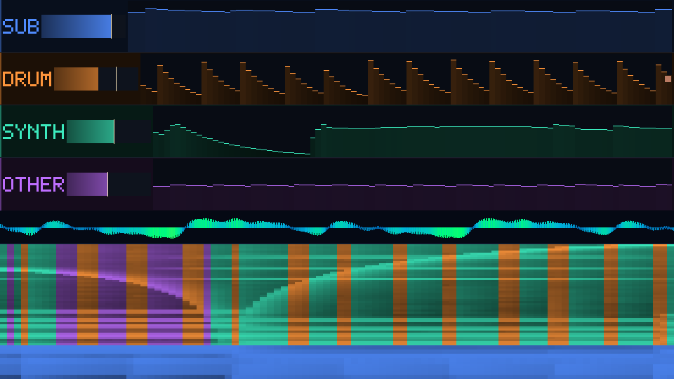
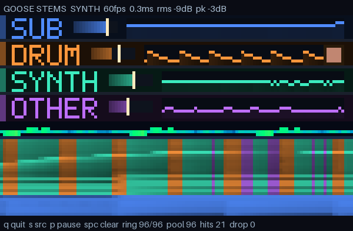

# Goose sample project (pixi)

A minimal [pixi](https://pixi.sh) project that installs the **Goose compiler**
from the `nandi-testing` channel and runs four small programs with it,
including a realtime audio visualizer.

Goose is a memory-safe systems language with no heap allocator, garbage
collector, or lifetime annotations. It compiles to C and can run programs
in-process through a bundled TinyCC backend. This package is the compiler,
not the unrelated "goose" AI agent.

- Package page: <https://prefix.dev/channels/nandi-testing/packages/goose>
- Package: `goose` `2026.3.post100` (`hb0f4dca_0`)
- Channel: <https://prefix.dev/nandi-testing> (plus `conda-forge` for anything else)
- Platform: **linux-64 only**

## Prerequisites

- Linux x86_64 with glibc 2.28 or newer (this lock file records `__glibc=2.28`).
- [pixi](https://pixi.sh) 0.83 or newer:

  ```bash
  curl -fsSL https://pixi.sh/install.sh | bash
  ```

- For in-process runs (`pixi run demo`, `pixi run iteration`,
  `pixi run realtime`) the host needs system C library headers: `libc6-dev`
  on Debian/Ubuntu, `glibc-devel` on Fedora/RHEL. The same applies to the
  `stack-stats` tasks.
- The visualizer has a small C sidecar (`src/capture.c`, `src/host.c`).
  Goose compiles it with the host C compiler even for an in-process run, so
  `pixi run viz` and `pixi run screenshot` need `gcc` or `clang`. No audio
  development headers or new pixi packages are needed: miniaudio loads
  ALSA/PulseAudio/JACK at run time.
- For native builds (`pixi run build`, `pixi run run-native`,
  `pixi run run-iteration-native`, `pixi run run-realtime-native`,
  `pixi run run-viz-native`) the host needs a C compiler (`gcc` or `clang`)
  on `PATH`. Run `pixi run toolchain` to see what Goose found.

All four demos were verified with gcc 15.2.0 on the host.

## Install

From this directory:

```bash
pixi install
```

`pixi.toml` already contains both channels and the package, so no other setup
is needed. `pixi.lock` pins the exact solution.

To recreate the dependencies from scratch instead:

```bash
pixi workspace channel add --prepend https://prefix.dev/nandi-testing
pixi add goose
```

## What the demos show

`demo.goose` is a language warm-up: a struct, recursion, growable arrays,
slices, and printing.

`iteration.goose` is the heap-less worker/service shape:

- each pass builds a request line in a loop-local growable buffer;
- `handle()` parses it with a stack-local normalization buffer and returns a
  flat record, so both scratch buffers are freed at scope exit with no
  allocator call;
- the newest six records live in a fixed-capacity ring backed by a `reusable`
  pool. When the ring is full, the oldest slot is freed and immediately reused;
- the final line reports `pool slots=6`, showing the steady state never grows.

`realtime.goose` is the fixed-cadence shape:

- tick `k` has the logical deadline `k * 1 ms`; the timer is simulated, so the
  demo measures compute time without OS sleep jitter;
- every tick hashes a fixed 1024-byte stack-local scratch buffer, then offers a
  flat `Sample` to a 16-entry outbox in a `reusable` pool;
- a deliberately slower consumer drains one sample every four ticks. When the
  outbox is full, the new sample is dropped and counted: explicit backpressure,
  not unbounded buffering and not a blocking producer;
- freed slots are reused, so `pool slots=16/16` is the high-water mark and the
  queue never grows. The summary reports min/avg/max compute time and overruns
  (compute longer than the simulated period);
- there is no per-tick allocation and no printing in the hot path, so the
  compute-time band stays tight and there are no GC pauses.

`visualizer.goose` is the realtime stem-aware audio visualizer:

| Offscreen 960x540 (`pixi run screenshot`) | ANSI terminal, captured through a 120x36 pty |
| --- | --- |
|  |  |

- `src/capture.c` opens the default capture device through vendored
  miniaudio: 48 kHz, mono f32, 256-frame periods. Its callback writes into a
  fixed 32768-frame single-producer/single-consumer ring. The callback does no
  allocation, locking or waiting; `cap_read` drains it from the Goose loop.
- the hot loop keeps a 2048-sample ring, applies a Hann window and runs an
  in-place radix-2 FFT. Twiddles and the bit-reversal table are built once.
  64 log-spaced bands remain the basis of the spectrogram; the mix is split
  into four labelled stem lanes:
  - `SUB` — low energy, 30–180 Hz, blue.
  - `DRUM` — high-band spectral flux (1.5–16 kHz) with an adaptive flux floor,
    a fast transient envelope and a high-frequency ratio; amber, with a compact
    hit blinker. A 100 ms refractory stops one hit from retriggering.
  - `SYNTH` — prominent harmonic peaks from 180 Hz to 8 kHz, where a bin must
    be a local maximum and at least 1.6x its neighbours; cyan/green.
  - `OTHER` — the broadband mid/high residual after subtracting tonal peaks
    and transient flux; violet.
- each lane has a 5x7 pixel label drawn into the framebuffer, a current-level
  meter, a peak-hold marker, and a sparkline of its own level over the shared
  96-frame history pool. The `DRUM` lane also draws the transient blinker.
  The spectrogram is tinted by the dominant stem in each history frame (low
  bands stay sub-blue), so drum-heavy and synth-heavy passages differ at a
  glance in both ANSI and PNG.
- a software RGB framebuffer is drawn from the stem lanes, the waveform and
  the 96-column spectrogram. The terminal path turns each 1x2 pixel pair into
  a `▀` with truecolor foreground and background; `--png` writes the same
  framebuffer as a PNG. `src/host.c` handles raw mode, terminal size,
  non-blocking keys and the PNG write.
- all long-lived state is preallocated. Samples, FFT scratch, magnitude and
  previous-magnitude arrays, stem targets/levels/peaks, the pixel font, the
  framebuffer, the ANSI frame and the header/footer buffers are fixed-size or
  fixed-capacity arrays. The history is a `reusable` pool of 96 `Snap` records
  holding both the 64-band spectrum and the four stem levels, allocated once
  at startup; when the ring is full the oldest slot is freed and the new one
  reuses it. The footer reports `ring 96/96  pool 96`, so the pool never grows.
  Per-frame scratch (the `Snap` value passed to `alloc_index`, FFT and draw
  locals, format temporaries) is stack-scoped and discarded at the end of the
  iteration. There is no grow-only array in the frame loop.
- smoothing is time-based one-pole attack/release, not per-frame constants, so
  the lanes read the same at 30 and 60 fps; `--fps 60` is supported. The
  spectrogram bands and stem envelopes use separate taus.
- live capture is used when a device exists. If miniaudio falls back to its
  Null backend (no `/dev/snd`, a container, CI) the program says so and
  switches to a deterministic synthetic riff, so the FFT and renderer still
  run. `--synthetic` forces the test signal, `--live` forces the silent device.
- keys: `q` quit, `s` toggle synthetic/live, `p` pause, space clears stem
  peak-holds.
- quick start: `pixi run viz`; see
  [Run the visualizer](#run-the-visualizer) for native, PNG and flag forms.

**Stem tuning knobs** (all in `visualizer.goose`):

- band edges at the top: `SUB_HZ_LO/HI` 30/180 Hz, `MID_HZ_HI` 2 kHz,
  `HIGH_HZ_HI` 16 kHz, `FLUX_HZ_LO` 1.5 kHz, `TONAL_HZ_HI` 8 kHz;
- harmonic prominence: a tonal bin must exceed its neighbours by 1.6x;
- onset: flux floor factor 1.4, onset threshold 0.30, 100 ms refractory; the
  flux baseline adapts with a 0.70 s time constant;
- lane energy references: sub ×4, synth ×2, other ×64 relative to a
  full-scale sine (N/4), inside `analyze()`;
- attack/release time constants: spectrogram bands 20/250 ms, sub 20/300 ms,
  drum 6/160 ms, synth 20/350 ms, other 30/400 ms; peak-hold falls 0.55/s;
  blinker decays with a 110 ms time constant.

`pixi run stack-stats`, `pixi run realtime-stack-stats` and
`pixi run viz-stack-stats` add `-DGS_STACK_STATS=1` and report the
compiler-assigned data stacks at exit:

```text
# iteration.goose
goose stack stats: main: 3 data stacks, 5 regions (reserving 2 GB each); budget 32 TB for 16376, main program 5, no workers
# realtime.goose
goose stack stats: main: 1 data stacks, 4 regions (reserving 2 GB each); budget 32 TB for 16376, main program 4, no workers
# visualizer.goose (the task passes --stack-reserve 64M)
goose stack stats: main: 12 data stacks, 15 regions (reserving 64 MB each); budget 32 TB for 516222, main program 15, no workers
```

The reservation is address space, not committed memory; it is the upper bound
for all dynamic data. The default is 2 GB *virtual* per data stack, so the
process VSZ can look large on a small VM even when RSS is tiny. Lower it for a
constrained container or a strict `RLIMIT_AS`:

```bash
pixi run goose --stack-reserve 64M iteration.goose   # minimum is 64 KB
```

The runtime halves a reservation the platform refuses. This is the pattern for
request-, job-, frame-, or batch-scoped work. Per-unit scratch belongs in
locals; state that outlives one unit must be bounded up front and pooled.

The visualizer gets 12 data stacks because its large framebuffer and the nested
draw/format calls each get a stack. At the default 2 GB reserve that is 24 GB of
*virtual* address space even though the arrays it actually touches are about
3 MB. `pixi run viz-stack-stats` therefore passes `--stack-reserve 64M`; use
the same flag in a container with a strict `RLIMIT_AS`.

The request loop is the "scope is the unit of work" pattern analysed in
[`docs/heap-less-app-guide.md`](docs/heap-less-app-guide.md) §6.1; the pool ring
is §6.3.

## Run

### Run the visualizer

The visualizer is a **terminal UI, not a windowed GUI**. It draws truecolor
half-blocks in the current terminal; there is no SDL/gfx window in this
package. If by GUI you mean a window, this environment cannot open one: the
`gfx` package is not built into the pinned conda Goose (see
[Platform caveats](#platform-caveats)). The terminal UI and the PNG output are
the supported renderers. From the project root:

```bash
pixi install          # once
pixi run viz          # live capture if a device exists, else synthetic
```

Quit with `q` (or Ctrl-C). The same UI from a native build:

```bash
pixi run run-viz-native
```

Headless output instead of the terminal:

```bash
pixi run screenshot   # writes screenshots/visualizer.png (960x540)
pixi run viz-bench    # hot-loop benchmark, no terminal or window
pixi run viz-bench-native
```

To pass flags, use the direct Goose command; options go after `--`:

```bash
pixi run goose --stack-reserve 64M visualizer.goose -- --synthetic --seconds 5
pixi run goose --stack-reserve 64M visualizer.goose -- --synthetic --fps 60 --seconds 5
pixi run goose --stack-reserve 64M visualizer.goose -- --synthetic --png /tmp/vis.png --frames 240
pixi run goose --stack-reserve 64M visualizer.goose -- --list
pixi run goose --stack-reserve 64M visualizer.goose -- --device "USB" --fps 60
```

For a pixi task, a second `--` is needed to reach the program:
`pixi run viz -- -- --synthetic --seconds 5`.

**Live capture requirements:** `pixi run viz` opens the default capture device
through miniaudio (ALSA, PulseAudio or JACK, loaded at run time) at 48 kHz mono
f32. No audio development headers or extra pixi packages are needed. If the
machine has no capture device (container, CI, no `/dev/snd`), miniaudio falls
back to its Null backend and the program says so and uses its deterministic
synthetic signal. `--list` shows devices, `--device NAME` picks one by name
substring, and `--live` keeps a silent device instead of switching to synthetic.
Terminal mode needs a TTY with 24-bit color; if stdout is not a TTY the program
exits with a hint, so use `pixi run screenshot` or `--png`/`--bench` instead.

### All tasks

```bash
pixi run demo                   # basic demo, in-process
pixi run iteration              # heap-less request/ring demo, in-process
pixi run realtime               # fixed-cadence loop demo, in-process
pixi run viz                    # live audio visualizer, ANSI terminal, in-process
pixi run check                  # typecheck all four programs
pixi run build                  # build native ./demo, ./iteration, ./realtime, ./visualizer
pixi run build-viz              # build only ./visualizer
pixi run run-native             # build, then run ./demo
pixi run run-iteration-native   # build, then run ./iteration
pixi run run-realtime-native    # build, then run ./realtime
pixi run run-viz-native         # build, then run ./visualizer
pixi run stack-stats            # iteration demo + data-stack high-water mark
pixi run realtime-stack-stats   # realtime demo + data-stack high-water mark
pixi run viz-stack-stats        # visualizer + data-stack high-water mark
pixi run screenshot             # write screenshots/visualizer.png
pixi run viz-bench              # headless visualizer benchmark, in-process
pixi run viz-bench-native       # build, then native visualizer benchmark
pixi run version                # Goose runtime version
pixi run toolchain              # C compiler, cmake, git, GOOSE_HOME
```

Direct use works too:

```bash
pixi run goose demo.goose
pixi run goose iteration.goose
pixi run goose realtime.goose
pixi run goose build realtime.goose && ./realtime

pixi run goose --stack-reserve 64M visualizer.goose                        # live capture, terminal
pixi run goose --stack-reserve 64M visualizer.goose -- --synthetic --seconds 5
pixi run goose --stack-reserve 64M visualizer.goose -- --synthetic --fps 60 --seconds 5
pixi run goose --stack-reserve 64M visualizer.goose -- --synthetic --png /tmp/vis.png --frames 240
pixi run goose --stack-reserve 64M visualizer.goose -- --list              # capture devices
pixi run goose --stack-reserve 64M visualizer.goose -- --bench --frames 240
pixi run goose build --stack-reserve 64M visualizer.goose && ./visualizer --synthetic
```

Expected output of `pixi run demo`:

```text
Goose demo: primes and Fibonacci
primes below 30: [2, 3, 5, 7, 11, 13, 17, 19, 23, 29]
count=10 largest=29
fib(0..9): [0, 1, 1, 2, 3, 5, 8, 13, 21, 34]
sum(fib)=88
```

Expected output of `pixi run iteration`:

```text
Goose heap-less request loop: 6-entry ring in a reusable pool
req 3: GET /api/items/3 200 623 -> hash=2894808507 ring=4/6 pool slots=4
req 7: GET /api/items/0 200 771 -> hash=2911586126 ring=6/6 pool slots=6
req 11: GET /api/items/4 200 919 -> hash=2978696602 ring=6/6 pool slots=6
req 15: GET /api/items/1 200 1067 -> hash=2928363745 ring=6/6 pool slots=6
req 19: GET /api/items/5 200 1215 -> hash=2995474221 ring=6/6 pool slots=6
req 23: GET /api/items/2 200 1363 -> hash=2878030888 ring=6/6 pool slots=6
-- newest first --
  /api/items/2 status=200 bytes=1363 hash=2878030888
  /api/items/1 status=200 bytes=1326 hash=2928363745
  /api/items/0 status=200 bytes=1289 hash=2911586126
  /api/items/6 status=200 bytes=1252 hash=2945141364
  /api/items/5 status=200 bytes=1215 hash=2995474221
  /api/items/4 status=200 bytes=1178 hash=2978696602
pool slots=6 (capacity 6, no growth)
```

Expected output of `pixi run realtime` (compute times vary by machine and run;
the band, not the exact numbers, is the point):

```text
Goose realtime loop: 300 ticks @ 1000000 ns simulated cadence, work=1024 bytes
tick 0 deadline=0 ns compute=9830 ns queue=0/16
tick 50 deadline=50000000 ns compute=9720 ns queue=16/16
tick 100 deadline=100000000 ns compute=9740 ns queue=15/16
tick 150 deadline=150000000 ns compute=9980 ns queue=16/16
tick 200 deadline=200000000 ns compute=9780 ns queue=15/16
tick 250 deadline=250000000 ns compute=9640 ns queue=16/16
accepted=91 dropped=209 drained=75 queued=16
pool slots=16/16 (high-water, never grows)
compute ns: min=9590 avg=10165 max=89550 overruns=0
```

Expected output of `pixi run viz-bench` and `pixi run viz-bench-native` on
this host (numbers vary by machine; the point is the headroom at 30 and 60 fps):

```text
# JIT (goose run)
bench: frames=240 size=960x540 avg_ms=9.0 min_ms=8.2 max_ms=10.5 pool=96/96 audio_s=8
       stems sub=83 drum=52 synth=56 other=49 hits=33 onset_avg=14 onset_max=100
       implied headroom: 110 frames/s (analysis+render only)

# native (goose build)
bench: frames=600 size=960x540 avg_ms=2.1 min_ms=1.9 max_ms=2.9 pool=96/96 audio_s=20
       stems sub=83 drum=49 synth=34 other=49 hits=80 onset_avg=13 onset_max=100
       implied headroom: 470 frames/s (analysis+render only)
```

Stem percentages are sampled at the final frame; the synthetic riff changes
every two seconds, so they move. On this host `pixi run viz-bench` at 60 fps
(480 frames) still runs well under the 16.7 ms frame budget, and the time-based
attack/release keeps the lane envelopes the same shape at 30 and 60 fps.

`pixi run goose visualizer.goose -- --list` prints what miniaudio found. In
this headless environment it is only the Null fallback:

```text
capture devices: 1
  [0] NULL Capture Device (default)
```

Goose prints parse/typecheck progress lines on stderr before the program
output. The `pixi run` demo tasks keep the compiler's exit code.

## Resolved versions

`pixi list` after `pixi install`:

| Package | Version | Build |
| --- | --- | --- |
| goose | 2026.3.post100 | hb0f4dca_0 |
| libstdcxx | 16.2.0 | h934c35e_7 |
| libgcc | 16.2.0 | ha9f2e26_7 |
| libgomp | 16.2.0 | he0feb66_7 |
| _openmp_mutex | 4.5 | 20_gnu |

All five resolve from the `nandi-testing` channel. The package declares
`libstdcxx >=16` and `libgcc >=16`; the channel also carries those builds, so
they win over conda-forge at the default channel priority.

`goose version` reports:

```text
goose runtime a5dbd11b6309
```

## Platform caveats

- **linux-64 only.** There is no osx-64, osx-arm64, win-64, or linux-aarch64
  build of `goose` in this channel. `pixi.toml` therefore declares only
  `platforms = ["linux-64"]`; adding another platform makes the solve fail.
- The in-process TinyCC backend borrows the host glibc headers. Without
  `libc6-dev`/`glibc-devel`, `pixi run demo`, `pixi run iteration`, and
  `pixi run realtime` fail while compiling the generated C; `goose check`
  still works.
- `goose build` delegates to the host C compiler and needs `gcc`/`clang`.
  It writes the generated C and runtime objects under `GOOSE_HOME`
  (default `~/.goose`), not into this directory.
- **Threads need a native build.** The in-process TinyCC backend cannot place
  thread-local storage, so a program that starts `thread_fn` workers must be
  run with `goose build` (for example `pixi run run-realtime-native`). The
  four demos are single-threaded in Goose and run in-process. The visualizer's
  capture callback runs on a miniaudio C thread, not a Goose `thread_fn`, so
  it does not need the native build.
- `realtime.goose` uses a **simulated** timer: deadlines are logical tick
  numbers, not wall-clock sleeps. It measures compute time, so OS scheduling
  jitter is excluded. It demonstrates the allocation and backpressure shape,
  not a hard real-time guarantee; that also needs a native build and an OS
  scheduling policy.
- `gfx`, `audio`, `ui`, and `physics` are **not built into this conda
  package** (`pixi run toolchain` reports `built in: no packages`). The first
  `import gfx;` fetches `github.com/aardappel/goose_gfx@v1` into
  `~/.goose/pkg`, and `goose check` then works. Building a program that
  actually calls gfx/audio needs CMake 3.20 or later plus SDL/X11/Wayland
  development libraries. This environment has no `cmake`, so such a build
  stops at `cannot find cmake`. Add `cmake` to the environment or use a
  prebuilt compiler release with the packages built in. The visualizer does
  not use these packages.
- **Audio capture needs a device and an audio backend.** The sidecar uses
  miniaudio, which loads `libasound.so.2`, `libpulse.so.0` or JACK with
  `dlopen` at run time. No development headers or extra pixi packages are
  needed. In a headless container there is no `/dev/snd`; miniaudio falls back
  to its Null backend, which delivers silence, and the program switches to its
  synthetic source. `--live` keeps the silent device, `--synthetic` forces the
  test signal. Device and backend behavior on real hardware (latency, device
  loss, resampling) is not exercised by the headless tests here.
- **Terminal output needs a TTY with 24-bit color and Unicode half blocks.**
  If stdout is not a TTY, the program stops with a hint instead of writing
  escape codes into a pipe; use `--png PATH` or `--bench`. Truecolor
  foreground and background are emitted per cell, about 60 KB per 80x24 frame
  (more at larger sizes). Reduce `--fps` or the terminal size over a slow
  link. `screenshots/terminal.png` was captured through a 120x36 pty;
  `screenshots/visualizer.png` is the same framebuffer written by `--png`, not
  a phone photo of a monitor.
- **The visualizer reserves 12 data stacks.** At the default 2 GB each that is
  24 GB of virtual address space (RSS stays small). The `viz-*` and
  `build-viz` tasks pass `--stack-reserve 64M` for this reason; see
  `viz-stack-stats` and the stack-reserve note above. The PNG save uses
  vendored `stb_image_write`, which allocates while writing the file, never in
  the frame loop.
- Only one version (`2026.3.post100`) is currently published in the channel.

## Reusing the loop for audio

The demos are plain root files. There is no framework to adopt: create
`audio.goose` beside them and keep the same shape.

- Fix the block size and cadence. For example, 128 frames at 48 kHz is about
  2.67 ms per block; set `PERIOD_NS` to `2670000` and use the same deadline
  bookkeeping as `realtime.goose`.
- Keep input, output, and analysis scratch as locals in the per-block
  function. They are on data stacks and die when the block returns.
- Keep history and UI telemetry in a bounded `reusable` pool ring. When it is
  full, drop and count: never grow, block, or allocate in the block path.
- Do not print or format from the audio path. Publish flat snapshots to the
  UI side and drain the ring there.
- Run it with `pixi run goose audio.goose`, or add pixi tasks for build/run
  beside the existing ones.

`visualizer.goose` is the full worked example of this split. Capture lives in
the C sidecar because device I/O and the audio thread belong in native code;
windowing, the FFT, band mapping, smoothing, peak hold and all drawing stay in
Goose. It renders with ANSI half blocks and a PNG framebuffer, so it
does not need the `gfx` package. `docs/examples/audio-frame-loop.goose` is a
smaller FFT-only sketch of the same hot loop.

## Files

- `pixi.toml` — channels, platform, dependency, and tasks.
- `pixi.lock` — exact resolved environment.
- `demo.goose` — language warm-up: structs, recursion, loops, slices, printing.
- `iteration.goose` — heap-less request loop: per-request scratch on a data
  stack plus a bounded ring of recent records in a `reusable` pool.
- `realtime.goose` — fixed-cadence loop: per-tick stack scratch, a bounded
  outbox in a `reusable` pool, and explicit drop-on-full backpressure.
- `visualizer.goose` — realtime stem-aware audio visualizer: capture ring,
  Hann window, FFT, sub/drum/synth/other lanes, flux onsets, harmonic peaks,
  ANSI terminal and PNG rendering.
- `visualizer.build` — the sidecar: compiles `src/*.c` and links `m`,
  `pthread` and `dl`.
- `src/capture.c` — miniaudio capture into a fixed SPSC ring; device list,
  backend and error queries.
- `src/host.c` — raw terminal mode, size and key reads, PNG writer.
- `vendor/miniaudio.h` — miniaudio 0.11.25 (public domain / MIT-0); audio
  device capture and backend loading.
- `vendor/stb_image_write.h` — stb_image_write 1.16 (public domain / MIT);
  the PNG encoder.
- `screenshots/visualizer.png`, `screenshots/terminal.png` — the images above.
- `README.md` — this file.
